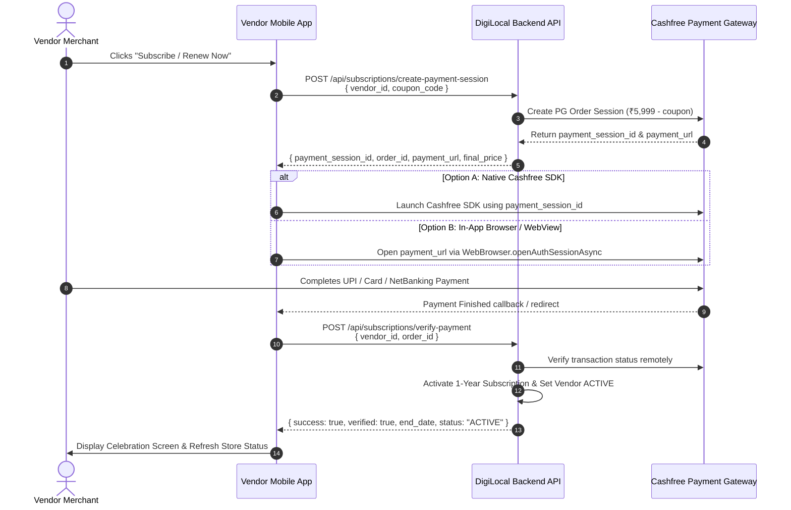

# Vendor Mobile App — Subscription Payment Integration Guide (Cashfree PG)

This documentation provides the complete integration specification for the **DigiLocal Vendor Mobile App (React Native Expo / Android / iOS)** to initiate real online payments for the **₹5,999/year Merchant Subscription**, apply promo coupons, and verify payment completion.

---

## 1. Architecture & Payment Flow



---

## 2. API Endpoints

### 2.1 Create Subscription Payment Session
Generates a real Cashfree Payment Gateway checkout session. Calculates plan pricing, validates and deducts coupon discounts, and creates a unique order identifier (`SUB_<timestamp>_<vendorId>`).

- **Endpoint:** `POST /api/subscriptions/create-payment-session`
- **Aliases:**
  - `POST /api/vendorPanel/:vendorId/subscription-session`
  - `POST /api/subscriptions/:vendorId/create-payment-session`
- **Headers:**
  - `Content-Type: application/json`
  - `Authorization: Bearer <VENDOR_ACCESS_TOKEN>` (optional if vendor_id provided in body)

#### Request Body:
```json
{
  "vendor_id": 1470,
  "plan_id": 1,
  "coupon_code": "SAVE2026",
  "return_url": "digilocalvendor://subscription/verify?order_id={order_id}"
}
```

| Field | Type | Required | Description |
| :--- | :--- | :--- | :--- |
| `vendor_id` | `number` | **Yes** | Vendor ID paying for the subscription |
| `plan_id` | `number` | No | Defaults to `1` (Annual Merchant Plan - ₹5,999.00/yr) |
| `coupon_code` | `string` | No | 8-character promo coupon (e.g. `SAVE2026`) |
| `return_url` | `string` | No | Custom app deep link for webview completion callback |

#### Response (200 OK):
```json
{
  "success": true,
  "payment_session_id": "session_live_9b4c0e62...",
  "order_id": "SUB_1792576228806_1470",
  "cf_order_id": "184910284",
  "order_amount": 5999.00,
  "order_currency": "INR",
  "original_price": 5999.00,
  "discount_amount": 0.00,
  "final_price": 5999.00,
  "coupon_applied": null,
  "payment_url": "https://payments.cashfree.com/order/#SUB_1792576228806_1470",
  "environment": "PRODUCTION",
  "vendor_id": 1470,
  "store_name": "Sharma Sweets & Grocery",
  "plan_id": 1,
  "plan_name": "Annual Merchant Plan"
}
```

---

### 2.2 Verify & Activate Subscription Payment
Called immediately after the vendor completes payment in Cashfree. The backend verifies the transaction with Cashfree, marks the coupon as used, grants a 1-year subscription (extends existing if active), updates the vendor store status to `ACTIVE`, and records the payment in the ledger.

- **Endpoint:** `POST /api/subscriptions/verify-payment`
- **Aliases:**
  - `POST /api/vendorPanel/:vendorId/verify-subscription`
  - `POST /api/subscriptions/:vendorId/verify-payment`
- **Headers:**
  - `Content-Type: application/json`
  - `Authorization: Bearer <VENDOR_ACCESS_TOKEN>`

#### Request Body:
```json
{
  "vendor_id": 1470,
  "order_id": "SUB_1792576228806_1470",
  "coupon_code": "SAVE2026"
}
```

#### Response (200 OK — Activated):
```json
{
  "success": true,
  "verified": true,
  "message": "Subscription activated successfully for 1 full year until 2027-10-21! Store is now visible on DigiLocal user portal.",
  "subscription_id": "252",
  "vendor_id": 1470,
  "store_name": "Sharma Sweets & Grocery",
  "plan_name": "Annual Merchant Plan",
  "start_date": "2026-10-21",
  "end_date": "2027-10-21",
  "final_price": 5999.00,
  "coupon_applied": null,
  "payment_method": "CASHFREE",
  "transaction_id": "CF_PAY_92819039_SUB_1792576228806_1470",
  "cashfree_order_id": "SUB_1792576228806_1470",
  "status": "ACTIVE",
  "shop_visible_on_portal": true
}
```

#### Idempotent Response (If already verified or handled by Webhook):
```json
{
  "success": true,
  "verified": true,
  "already_processed": true,
  "message": "Subscription is already active until 2027-10-21.",
  "subscription_id": "252",
  "vendor_id": 1470,
  "store_name": "Sharma Sweets & Grocery",
  "plan_name": "Annual Merchant Plan",
  "start_date": "2026-10-21",
  "end_date": "2027-10-21",
  "payment_method": "CASHFREE",
  "status": "ACTIVE",
  "shop_visible_on_portal": true
}
```

#### Response (400 Bad Request — Payment Failed or Cancelled):
```json
{
  "success": false,
  "verified": false,
  "payment_status": "FAILED",
  "order_id": "SUB_1792576228806_1470",
  "error": "Payment has not been completed or was declined by Cashfree"
}
```

---

## 3. React Native Mobile App Implementation

### Recommended Option: Expo WebBrowser / In-App Browser Checkout
This option requires zero native SDK linking and works smoothly on Android and iOS Expo applications.

```typescript
import * as WebBrowser from 'expo-web-browser';
import { Alert } from 'react-native';

export async function initiateVendorSubscription(vendorId: number, couponCode?: string) {
  try {
    // 1. Request Cashfree Payment Session from Backend
    const sessionRes = await fetch('https://api.digilocal.in/api/subscriptions/create-payment-session', {
      method: 'POST',
      headers: {
        'Content-Type': 'application/json',
      },
      body: JSON.stringify({
        vendor_id: vendorId,
        coupon_code: couponCode,
        return_url: 'https://digilocal.in/payments/cashfree/return?order_id={order_id}'
      })
    });

    const sessionData = await sessionRes.json();
    if (!sessionData.success || !sessionData.payment_url) {
      throw new Error(sessionData.error || 'Failed to initiate payment session');
    }

    const { order_id, payment_url } = sessionData;

    // 2. Open Cashfree Hosted Checkout in In-App Browser
    const browserResult = await WebBrowser.openAuthSessionAsync(
      payment_url,
      'https://digilocal.in/payments/cashfree/return'
    );

    // 3. Verify Payment Status with Backend
    const verifyRes = await fetch('https://api.digilocal.in/api/subscriptions/verify-payment', {
      method: 'POST',
      headers: {
        'Content-Type': 'application/json',
      },
      body: JSON.stringify({
        vendor_id: vendorId,
        order_id: order_id,
        coupon_code: couponCode
      })
    });

    const verifyData = await verifyRes.json();

    if (verifyData.success && verifyData.verified) {
      Alert.alert(
        '🎉 Subscription Activated!',
        `Your store is live on the DigiLocal resident portal until ${verifyData.end_date}.`
      );
      return { success: true, data: verifyData };
    } else {
      Alert.alert('Payment Incomplete', verifyData.error || 'Payment was not verified.');
      return { success: false, error: verifyData.error };
    }
  } catch (error: any) {
    Alert.alert('Error', error.message || 'Something went wrong processing payment.');
    return { success: false, error: error.message };
  }
}
```

---

## 4. Automatic Webhook Fallback
Even if the vendor's internet disconnects or they close the app before the return redirect finishes:
- Cashfree automatically dispatches a secure webhook to `POST /api/payments/cashfree/webhook`.
- The DigiLocal backend automatically verifies and activates the vendor subscription within seconds.
- On the next app launch or pull-to-refresh, calling `GET /api/vendorPanel/:vendorId/subscription-status` will return `status: "ACTIVE"` with the refreshed expiry date.
