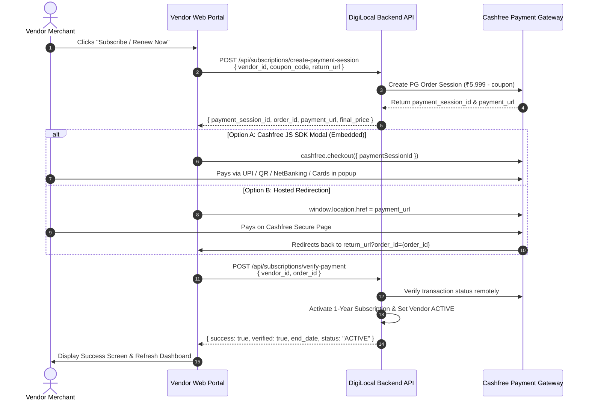

# Vendor Web Portal — Subscription Payment Integration Guide (Cashfree PG)

This documentation provides the integration specification for the **DigiLocal Vendor Web Portal (React / Next.js / Vue / Vanilla JS)** to integrate real online payments for the **₹5,999/year Merchant Subscription**, apply promo coupons, and verify payment completion using Cashfree Checkout.

---

## 1. Architecture & Payment Flow



---

## 2. API Endpoints

### 2.1 Create Subscription Payment Session
Generates a real Cashfree PG payment session. Calculates plan pricing, validates and deducts promo coupon discounts, and returns the session token and payment URL.

- **Endpoint:** `POST /api/subscriptions/create-payment-session`
- **Aliases:**
  - `POST /api/vendorPanel/:vendorId/subscription-session`
  - `POST /api/subscriptions/:vendorId/create-payment-session`
- **Headers:**
  - `Content-Type: application/json`
  - `Authorization: Bearer <VENDOR_ACCESS_TOKEN>`

#### Request Body:
```json
{
  "vendor_id": 1470,
  "plan_id": 1,
  "coupon_code": "SAVE2026",
  "return_url": "https://vendor.digilocal.in/subscription-verify?order_id={order_id}"
}
```

| Field | Type | Required | Description |
| :--- | :--- | :--- | :--- |
| `vendor_id` | `number` | **Yes** | Vendor ID paying for subscription |
| `plan_id` | `number` | No | Defaults to `1` (Annual Merchant Plan - ₹5,999.00/yr) |
| `coupon_code` | `string` | No | 8-character promo coupon (e.g. `SAVE2026`) |
| `return_url` | `string` | No | Page URL where Cashfree redirects the merchant after payment |

#### Response (200 OK):
```json
{
  "success": true,
  "payment_session_id": "session_live_9b4c0e62...",
  "order_id": "SUB_1792576228806_1470",
  "cf_order_id": "184910284",
  "order_amount": 5999.00,
  "order_currency": "INR",
  "original_price": 5999.00,
  "discount_amount": 0.00,
  "final_price": 5999.00,
  "coupon_applied": null,
  "payment_url": "https://payments.cashfree.com/order/#SUB_1792576228806_1470",
  "environment": "PRODUCTION",
  "vendor_id": 1470,
  "store_name": "Sharma Sweets & Grocery",
  "plan_id": 1,
  "plan_name": "Annual Merchant Plan"
}
```

---

### 2.2 Verify & Activate Subscription Payment
Verifies payment with Cashfree remote gateway, marks coupon as used, extends/activates subscription for 1 full year, updates vendor status to `ACTIVE`, and records transaction in the payments ledger.

- **Endpoint:** `POST /api/subscriptions/verify-payment`
- **Aliases:**
  - `POST /api/vendorPanel/:vendorId/verify-subscription`
  - `POST /api/subscriptions/:vendorId/verify-payment`
- **Headers:**
  - `Content-Type: application/json`
  - `Authorization: Bearer <VENDOR_ACCESS_TOKEN>`

#### Request Body:
```json
{
  "vendor_id": 1470,
  "order_id": "SUB_1792576228806_1470",
  "coupon_code": "SAVE2026"
}
```

#### Response (200 OK — Activated):
```json
{
  "success": true,
  "verified": true,
  "message": "Subscription activated successfully for 1 full year until 2027-10-21! Store is now visible on DigiLocal user portal.",
  "subscription_id": "252",
  "vendor_id": 1470,
  "store_name": "Sharma Sweets & Grocery",
  "plan_name": "Annual Merchant Plan",
  "start_date": "2026-10-21",
  "end_date": "2027-10-21",
  "final_price": 5999.00,
  "coupon_applied": null,
  "payment_method": "CASHFREE",
  "transaction_id": "CF_PAY_92819039_SUB_1792576228806_1470",
  "cashfree_order_id": "SUB_1792576228806_1470",
  "status": "ACTIVE",
  "shop_visible_on_portal": true
}
```

#### Idempotent Response (Already Activated):
```json
{
  "success": true,
  "verified": true,
  "already_processed": true,
  "message": "Subscription is already active until 2027-10-21.",
  "subscription_id": "252",
  "vendor_id": 1470,
  "store_name": "Sharma Sweets & Grocery",
  "plan_name": "Annual Merchant Plan",
  "start_date": "2026-10-21",
  "end_date": "2027-10-21",
  "payment_method": "CASHFREE",
  "status": "ACTIVE",
  "shop_visible_on_portal": true
}
```

#### Response (400 Bad Request — Payment Failed or Declined):
```json
{
  "success": false,
  "verified": false,
  "payment_status": "FAILED",
  "order_id": "SUB_1792576228806_1470",
  "error": "Payment has not been completed or was declined by Cashfree"
}
```

---

## 3. Web Implementation Examples

### Option A: Using Cashfree JS SDK (Embedded Seamless Modal Checkout)

1. Load Cashfree SDK script in your HTML / Next.js layout:
```html
<script src="https://sdk.cashfree.com/js/v3/cashfree.js"></script>
```

2. Checkout & Verification handler:
```javascript
// Initialize Cashfree Web SDK
const cashfree = Cashfree({ mode: "production" }); // Or "sandbox" for testing

async function handlePaySubscription(vendorId, couponCode) {
  try {
    // 1. Create Payment Session
    const sessionRes = await fetch('/api/subscriptions/create-payment-session', {
      method: 'POST',
      headers: { 'Content-Type': 'application/json' },
      body: JSON.stringify({
        vendor_id: vendorId,
        coupon_code: couponCode
      })
    });
    const sessionData = await sessionRes.json();

    if (!sessionData.success || !sessionData.payment_session_id) {
      alert(sessionData.error || 'Failed to initialize payment.');
      return;
    }

    // 2. Open Cashfree Popup Checkout
    cashfree.checkout({
      paymentSessionId: sessionData.payment_session_id,
      redirectTarget: "_modal" // Opens payment popup directly in page
    }).then(async (result) => {
      // 3. Verify Payment
      const verifyRes = await fetch('/api/subscriptions/verify-payment', {
        method: 'POST',
        headers: { 'Content-Type': 'application/json' },
        body: JSON.stringify({
          vendor_id: vendorId,
          order_id: sessionData.order_id,
          coupon_code: couponCode
        })
      });
      const verifyData = await verifyRes.json();

      if (verifyData.success && verifyData.verified) {
        alert('🎉 Subscription activated successfully for 1 year!');
        window.location.reload();
      } else {
        alert(verifyData.error || 'Payment verification failed.');
      }
    });

  } catch (err) {
    console.error('Subscription error:', err);
    alert('Payment processing error: ' + err.message);
  }
}
```

---

### Option B: Direct Hosted Page Redirection (Zero JS SDK Dependencies)

```javascript
async function redirectToCheckout(vendorId, couponCode) {
  const returnUrl = `${window.location.origin}/vendor/subscription-callback?order_id={order_id}`;

  const res = await fetch('/api/subscriptions/create-payment-session', {
    method: 'POST',
    headers: { 'Content-Type': 'application/json' },
    body: JSON.stringify({
      vendor_id: vendorId,
      coupon_code: couponCode,
      return_url: returnUrl
    })
  });
  const data = await res.json();

  if (data.success && data.payment_url) {
    // Redirect merchant to Cashfree secure payment page
    window.location.href = data.payment_url;
  } else {
    alert(data.error || 'Unable to open payment gateway.');
  }
}

// On the return page (/vendor/subscription-callback):
async function onReturnPageLoad() {
  const urlParams = new URLSearchParams(window.location.search);
  const orderId = urlParams.get('order_id');

  if (orderId) {
    const res = await fetch('/api/subscriptions/verify-payment', {
      method: 'POST',
      headers: { 'Content-Type': 'application/json' },
      body: JSON.stringify({ order_id: orderId })
    });
    const result = await res.json();
    if (result.success) {
      // Show celebration and redirect to dashboard
    }
  }
}
```

---

## 4. Webhook Reliability
Even if the vendor closes the browser window or navigates away during payment processing:
- Cashfree sends a server-to-server webhook callback to `/api/payments/cashfree/webhook`.
- The DigiLocal backend automatically activates the subscription and unlocks the store.
- On the next page load or dashboard visit, `GET /api/vendorPanel/:vendorId/subscription-status` reflects `status: "ACTIVE"` with the full 365-day validity period.
